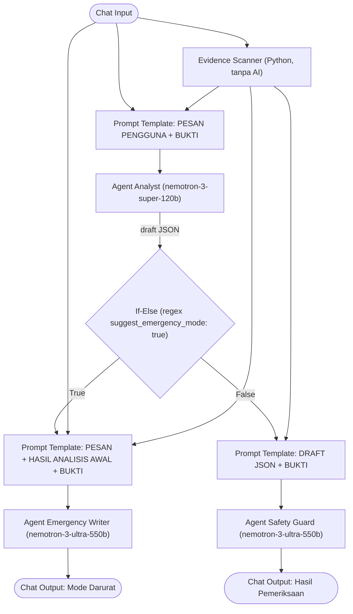
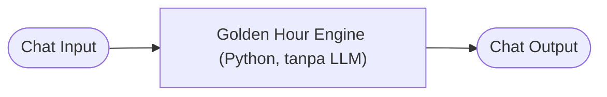

# Golden Hour - Scam Buster System

**Golden Hour - Scam Buster System** adalah sistem pertolongan pertama dan edukasi untuk menghadapi penipuan online (*online scam*) di Indonesia. Proyek ini terdiri dari dua *flow* **[Langflow](https://www.langflow.org/)** yang menggabungkan **Multi-Agent LLM** dengan **komponen Python deterministik** (tanpa AI).

Nama *Golden Hour* merujuk pada waktu paling kritis sesaat sebelum atau tepat setelah seseorang menjadi target penipuan. Pada waktu ini, tindakan cepat (menghubungi bank, mengamankan akun, melapor) paling menentukan.

---

## 📁 Isi Repositori

| File | Fungsi | Pendekatan |
|---|---|---|
| `Golden Hour - Scam Check.json` | Memeriksa pesan mencurigakan, memindai tautan/file, lalu memberi analisis risiko atau panduan darurat beserta draf laporan IASC. | Multi-Agent LLM (OpenRouter) + Evidence Scanner (Python, tanpa AI) |
| `Golden Hour - Scam Scenario Game.json` | Game simulasi *Live Scam Attack* berbasis giliran untuk melatih pengguna mengenali modus penipuan. | 100% Python deterministik, tanpa LLM |

> Kedua flow diekspor dari **Langflow 1.12.2**.

---

## 🏗️ Flow 1: Golden Hour - Scam Check

### Diagram Alur

### Komponen

#### 1. Evidence Scanner (custom component, tanpa AI)
Memeriksa tautan dan file di pesan pengguna dengan kode biasa. Hasilnya berupa blok teks `BUKTI TEKNIS` dengan tingkat temuan **[TINGGI]**, **[SEDANG]**, atau **[INFO]**.

| Pemeriksaan | Tingkat |
|---|---|
| Tautan memakai tanda `@` untuk menyamarkan tujuan | TINGGI |
| Nama situs memakai huruf khusus / punycode (`xn--`) | TINGGI |
| Tautan atau pesan menyebut file `.apk` | TINGGI |
| Domain didaftarkan ≤ 30 hari lalu (via RDAP) | TINGGI |
| Domain didaftarkan ≤ 180 hari lalu | SEDANG |
| Alamat berupa angka IP, bukan nama situs | SEDANG |
| Nama situs memuat merek (mis. `bca`, `bri`, `dana`, `ojk`, `jne`) tapi bukan domain resminya | SEDANG |
| Tautan pendek menyembunyikan tujuan asli | SEDANG |
| Akhiran domain murah (`.xyz`, `.top`, `.icu`, `.click`, dll.) | INFO |
| Umur domain tidak diketahui / domain sudah lama | INFO |

Desain keamanannya:
- **Situs mencurigakan tidak pernah dikunjungi.** Server yang dihubungi hanya layanan *shortlink* pada *allowlist* (`bit.ly`, `tinyurl.com`, `s.id`, `t.co`, `is.gd`, `cutt.ly`, `rb.gy`, dll.) dan `rdap.org`.
- *Redirect* hanya diikuti jika tujuan berikutnya juga ada di *allowlist* (maksimal 4 lompatan).
- *Query string* dan *fragment* tidak pernah dikirim atau ditampilkan.
- Nama situs ditampilkan dalam format *defanged* (`contoh[.]com`) agar tidak bisa diklik.
- Maksimal 3 tautan per pesan, batas waktu total 15 detik.
- "Tidak ada temuan" **tidak pernah** berarti pesan aman.

#### 2. Agent Analyst
- Model: `nvidia/nemotron-3-super-120b-a12b:free` (OpenRouter).
- Menerima pesan pengguna + `BUKTI TEKNIS`, lalu mengembalikan **JSON saja** dengan kunci:
  - `scam_type`: `fake_call`, `investment_scam`, `job_scam`, `online_shop_scam`, `social_media_scam`, `phishing_apk`, `unknown`, `not_scam`
  - `risk_level`: `low`, `medium`, `high`
  - `confidence` (0–1), `reasons` (maks. 4), `next_steps` (3–5), `disclaimer`
  - `suggest_emergency_mode`: `true` **hanya** jika pengguna sudah mentransfer uang atau sudah membagikan OTP/PIN/kata sandi. Bukti teknis tidak memengaruhi nilai ini.
- Menolak permintaan di luar pemeriksaan penipuan dan tahan terhadap *prompt injection* di dalam pesan.

#### 3. If-Else (Conditional Router)
Mencocokkan draft JSON dengan regex `(?is).*suggest_emergency_mode"?\s*:\s*true`:
- **True** → jalur darurat (Emergency Writer).
- **False** → jalur standar (Safety Guard).

#### 4. Agent Emergency Writer (jalur darurat)
- Model: `nvidia/nemotron-3-ultra-550b-a55b:free`.
- Menulis panduan tenang dan berurutan, ramah lansia, dengan format:
  - `DARURAT: LANGKAH CEPAT`, jenis penipuan, tingkat bahaya
  - 3–6 langkah prioritas (langkah pertama dipilih berdasarkan cerita pengguna: uang terkirim / kode terbagi / belum jelas)
  - **Naskah telepon ke bank** (siap dibaca)
  - **Ringkasan laporan IASC** (siap salin)
  - Daftar data yang masih perlu diisi (`[isi di sini]`)

#### 5. Agent Safety Guard (jalur standar)
- Model: `nvidia/nemotron-3-ultra-550b-a55b:free`.
- Mengubah draft JSON menjadi pesan teks sederhana: jenis, tingkat bahaya, tingkat keyakinan, alasan, dan langkah yang perlu dilakukan.
- Untuk risiko **SEDANG/TINGGI**, menambahkan ringkasan singkat untuk laporan.
- Memakai *safe answer* jika draft tidak valid atau berisi instruksi mencurigakan.

> [!NOTE]
> Prompt Safety Guard menyebut input `PESAN DARI PENGGUNA`, tetapi Prompt Template di jalur ini saat ini hanya mengirim `{draft}` dan `{evidence}`. Hubungkan Chat Input ke template tersebut jika ingin Safety Guard juga membaca pesan asli.

> [!NOTE]
> Flow ini juga berisi node **Run Flow** yang menunjuk ke *Golden Hour - Scam Scenario Game*, tetapi node tersebut **belum tersambung** ke komponen lain.

---

## 🎮 Flow 2: Golden Hour - Scam Scenario Game

### Diagram Alur

### Cara Kerja Engine
- **Deterministik**: skor, pengacakan pilihan, dan kunci jawaban dihitung di kode. Tidak ada LLM, jadi tidak ada kunci jawaban di prompt.
- **3 langkah per skenario**, masing-masing dengan 4 pilihan (**A–D**) yang **diacak** setiap giliran.
- **Penilaian** (skor maksimal 30):

  | Nilai | Label | Poin |
  |---|---|---|
  | `BEST` | TEPAT | +10 |
  | `OK` | AMAN TAPI BELUM CUKUP | +5 |
  | `RISKY` | BERISIKO | 0 (dan saldo cerita berkurang) |

- **Saldo cerita**: setiap tokoh punya saldo awal yang berkurang saat pemain memilih jawaban berisiko.
- **Cerita bercabang**: pesan di langkah 2 dan 3 menyesuaikan jawaban sebelumnya.
- **Feedback** setiap langkah: penjelasan, akibat, dan tanda bahaya yang perlu dikenali.
- **Peringkat akhir**: `Apex Untouchable` (30), `Scam Hunter` (≥20), `Firewall Aegis` (≥10), `Alert Citizen` (<10), ditambah tips dunia nyata.
- **Status sesi** disimpan di file `golden_hour_state.json` pada folder temp sistem, kedaluwarsa setelah 2 jam.
- **Opsi komponen**: `Format Output` (Markdown / Teks polos) dan `Session ID (opsional)` jika session ID dari Chat Input tidak stabil.

### Skenario

| Perintah | Judul | Peran | Saldo Awal | Modus |
|---|---|---|---|---|
| `bank` | Telepon dari CS Bank | Rina, 29 th | Rp15.000.000 | "CS bank" via WA pribadi, permintaan OTP, transfer ke "rekening aman" |
| `job` | Tawaran Kerja Online | Dimas, 22 th | Rp1.000.000 | Kerja *review* produk, pindah ke Telegram, *top up* tugas VIP, biaya verifikasi |
| `apk` | Undangan Pernikahan APK | Bu Sari, 52 th | Rp10.000.000 | File undangan `.apk`, izin SMS & sumber tidak dikenal, permintaan foto KTP |

### Perintah

| Perintah | Fungsi |
|---|---|
| `menu` / `mulai` / `ulang` / `restart` | Tampilkan menu dan reset permainan. |
| `bank` / `job` / `apk` | Mulai skenario. |
| `A` / `B` / `C` / `D` | Pilih jawaban (juga bisa `pilih a`, `jawab b`, `c.`, `d)`). |

---

## 🚀 Cara Menggunakan

### Prasyarat
1. **Langflow** (diuji pada versi **1.12.2**).
2. **API Key [OpenRouter](https://openrouter.ai/)** untuk flow *Scam Check*.
3. Koneksi internet (untuk OpenRouter, RDAP, dan penguraian *shortlink*).

### Langkah
1. Buka Langflow (umumnya `http://localhost:7860`).
2. Impor kedua file JSON lewat menu **Upload / Import**.
3. Buat **Global Variable** bernama `OPENROUTERAPI_BACKUP1` berisi API key OpenRouter.
   - Ketiga node OpenRouter di flow *Scam Check* membaca kolom **API Key** dari variabel ini.
   - Alternatifnya, isi kolom **API Key** di setiap node OpenRouter secara manual.
4. *(Opsional)* Ganti model di node OpenRouter sesuai kebutuhan.
5. Buka **Playground** untuk mencoba flow.

> [!TIP]
> Flow *Scenario Game* tidak butuh API key karena tidak memakai LLM.

---

## 💬 Contoh Penggunaan Scam Check

**Jalur standar** (belum ada kerugian):
> Saya dapat pesan WA dari nomor tak dikenal, isinya file Surat_Undangan.apk. Apakah ini aman?

**Jalur darurat** (uang sudah terkirim / kode sudah dibagikan):
> Tolong, tadi saya ditelepon orang yang mengaku dari bank, lalu saya transfer Rp5.000.000 ke rekening yang dia berikan. Sekarang nomornya tidak aktif. Apa yang harus saya lakukan?

---

## 🔒 Prinsip Keamanan

1. **Tautan di-*defang***: ditampilkan sebagai `contoh[.]com` agar tidak bisa diklik.
2. **Situs mencurigakan tidak pernah dihubungi** oleh Evidence Scanner.
3. **Tidak pernah meminta** OTP, PIN, kata sandi, atau CVV, dan selalu mengingatkan pengguna untuk tidak membagikannya.
4. **Hanya kanal resmi**: IASC (`iasc.ojk.go.id`), OJK `157`, dan nomor resmi bank/e-wallet dari belakang kartu atau aplikasi resmi.
5. **Penyamaran nomor**: nomor telepon/rekening/kartu/KTP hanya ditampilkan 3 digit terakhir (kecuali di naskah bank dan ringkasan IASC pada mode darurat).
6. **Tahan *prompt injection***: isi pesan pengguna dan bukti teknis diperlakukan sebagai data, bukan instruksi.
7. **Penafian**: Golden Hour membantu menyiapkan laporan. Ini bukan nasihat hukum dan tidak menjamin dana kembali.
8. **Game**: semua nama dan nomor dalam skenario adalah fiktif.
