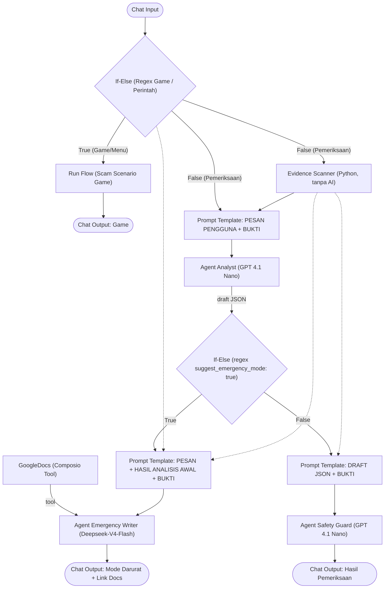

# Golden Hour - Scam Buster System

**Golden Hour - Scam Buster System** adalah sistem pertolongan pertama dan edukasi untuk menghadapi penipuan online (*online scam*) di Indonesia. Proyek ini terdiri dari dua *flow* **[Langflow](https://www.langflow.org/)** yang menggabungkan **Multi-Agent LLM** dengan **komponen Python deterministik** (tanpa AI).

Nama *Golden Hour* merujuk pada waktu paling kritis sesaat sebelum atau tepat setelah seseorang menjadi target penipuan. Pada waktu ini, tindakan cepat (menghubungi bank, mengamankan akun, melapor) paling menentukan.

---

## 📁 Isi Repositori

| File | Fungsi | Pendekatan |
|---|---|---|
| `Golden Hour - Scam Check.json` | Memeriksa pesan mencurigakan, memindai tautan/file, lalu memberi analisis risiko atau panduan darurat beserta draf laporan IASC. | Multi-Agent LLM (Flaz.id) + Evidence Scanner (Python, tanpa AI) |
| `Golden Hour - Scam Scenario Game.json` | Game simulasi *Live Scam Attack* berbasis giliran untuk melatih pengguna mengenali modus penipuan. | 100% Python deterministik, tanpa LLM |

> Kedua flow diekspor dari **Langflow 1.12.2**.

---

## 🏗️ Flow 1: Golden Hour - Scam Check

### Diagram Alur



### Komponen

#### 1. Router Perintah Awal (If-Else)
Mendeteksi apakah pesan pengguna merupakan perintah game atau jawaban kuis menggunakan regex cerdas:
`(?is)(^\s*(menu|mulai|ulang|restart|bank|job|apk|[a-d])\s*[.)]?$|.*\b(ngegame|game|simulasi|kuis)\b.*)`
- **True** → Langsung diarahkan ke **Run Flow** (Game) tanpa membebani LLM, memastikan latensi instan dan hemat token.
- **False** → Diteruskan ke alur analisis penipuan (Evidence Scanner & Agent Analyst).

#### 2. Run Flow (Sub-flow Runner)
Menjalankan alur *Golden Hour - Scam Scenario Game* secara langsung dari dalam flow pemeriksaan, dengan output pesan diteruskan ke **Chat Output Game**.

#### 3. Evidence Scanner (custom component, tanpa AI)
Memeriksa tautan dan file di pesan pengguna dengan kode biasa. Hasilnya berupa blok teks `BUKTI TEKNIS` dengan tingkat temuan **[TINGGI]**, **[SEDANG]**, atau **[INFO]**.

| Pemeriksaan | Tingkat |
|---|---|
| Tautan memakai tanda `@` untuk menyamarkan tujuan | TINGGI |
| Nama situs memakai huruf khusus / punycode (`xn--`) | TINGGI |
| Tautan atau pesan menyebut file `.apk` | TINGGI |
| Domain didaftarkan ≤ 30 hari lalu (via RDAP) | TINGGI |
| Domain didaftarkan ≤ 180 hari lalu | SEDANG |
| Alamat berupa angka IP, bukan nama situs | SEDANG |
| Nama situs memuat merek (mis. `bca`, `bri`, `dana`, `ojk`, `jne`) tapi bukan domain resminya | SEDANG |
| Tautan pendek menyembunyikan tujuan asli | SEDANG |
| Akhiran domain murah (`.xyz`, `.top`, `.icu`, `.click`, dll.) | INFO |
| Umur domain tidak diketahui / domain sudah lama | INFO |

Desain keamanannya:
- **Situs mencurigakan tidak pernah dikunjungi.** Server yang dihubungi hanya layanan *shortlink* pada *allowlist* (`bit.ly`, `tinyurl.com`, `s.id`, `t.co`, `is.gd`, `cutt.ly`, `rb.gy`, dll.) dan `rdap.org`.
- *Redirect* hanya diikuti jika tujuan berikutnya juga ada di *allowlist* (maksimal 4 lompatan).
- *Query string* dan *fragment* tidak pernah dikirim atau ditampilkan.
- Nama situs ditampilkan dalam format *defanged* (`contoh[.]com`) agar tidak bisa diklik.
- Maksimal 3 tautan per pesan, batas waktu total 15 detik.
- "Tidak ada temuan" **tidak pernah** berarti pesan aman.

#### 4. Agent Analyst
- Model: `GPT 4.1 Nano` (flaz.id).
- Menerima pesan pengguna + `BUKTI TEKNIS`, lalu mengembalikan **JSON saja** dengan kunci:
  - `scam_type`: `fake_call`, `investment_scam`, `job_scam`, `online_shop_scam`, `social_media_scam`, `phishing_apk`, `unknown`, `not_scam`
  - `risk_level`: `low`, `medium`, `high`
  - `confidence` (0–1), `reasons` (maks. 4), `next_steps` (3–5), `disclaimer`
  - `suggest_emergency_mode`: `true` **hanya** jika pengguna sudah mentransfer uang atau sudah membagikan OTP/PIN/kata sandi. Bukti teknis tidak memengaruhi nilai ini.
- Menolak permintaan di luar pemeriksaan penipuan dan tahan terhadap *prompt injection* di dalam pesan.

#### 5. If-Else (Router Darurat)
Mencocokkan draft JSON dengan regex `(?is).*suggest_emergency_mode"?\s*:\s*true`:
- **True** → jalur darurat (Emergency Writer).
- **False** → jalur standar (Safety Guard).

#### 6. Agent Emergency Writer & Google Docs Integration (jalur darurat)
- Model: `Deepseek-V4-Flash`.
- **Integrasi Tool GoogleDocs (Composio)**: Otomatis memanggil tool `googledocs_create_document` untuk membuat draf laporan insiden lengkap dan siap pakai di Google Docs dengan format nomor referensi unik (`GH-[YYYYMMDD]-[4_KARAKTER]`).
- Menulis panduan tenang dan berurutan, ramah lansia, dengan format:
  - `DARURAT: LANGKAH CEPAT`, jenis penipuan, tingkat bahaya
  - 3–6 langkah prioritas (langkah pertama disesuaikan dengan situasi: uang terkirim / kode terbagi / belum jelas)
  - **Naskah telepon ke bank** (siap dibaca)
  - **Ringkasan laporan IASC** (siap salin)
  - **Dokumen laporan (Google Docs)**: Tautan URL dokumen laporan resmi siap cetak untuk dibawa ke bank atau kepolisian
  - Daftar data yang masih perlu diisi (`[isi di sini]`)

#### 7. Agent Safety Guard (jalur standar)
- Model: `GPT 4.1 Nano`.
- Mengubah draft JSON menjadi pesan teks sederhana: jenis, tingkat bahaya, tingkat keyakinan, alasan, dan langkah yang perlu dilakukan.
- Untuk risiko **SEDANG/TINGGI**, menambahkan ringkasan singkat untuk laporan.
- Memakai *safe answer* jika draft tidak valid atau berisi instruksi mencurigakan.

> [!NOTE]
> Prompt Safety Guard menyebut input `PESAN DARI PENGGUNA`, tetapi Prompt Template di jalur ini saat ini hanya mengirim `{draft}` dan `{evidence}`. Hubungkan Chat Input ke template tersebut jika ingin Safety Guard juga membaca pesan asli.

---

## 🎮 Flow 2: Golden Hour - Scam Scenario Game

### Diagram Alur


### Cara Kerja Engine
- **Deterministik**: skor, pengacakan pilihan, dan kunci jawaban dihitung di kode. Tidak ada LLM, jadi tidak ada kunci jawaban di prompt.
- **Pemicu Masukan Fleksibel**: Mendukung input bahasa alami di awal percakapan (seperti *"aku mau ngegame dong"*, *"main game"*, *"simulasi"*, *"kuis"*) untuk langsung membuka menu, serta mendukung pemilihan skenario menggunakan angka (`1`, `2`, `3`) maupun kata kunci (`bank`, `job`, `apk`).
- **3 langkah per skenario**, masing-masing dengan 4 pilihan (**A–D**) yang **diacak** setiap giliran.
- **Penilaian per skenario** (skor maksimal 30 per skenario):

  | Nilai | Label | Poin |
  |---|---|---|
  | `BEST` | TEPAT | +10 |
  | `OK` | AMAN TAPI BELUM CUKUP | +5 |
  | `RISKY` | BERISIKO | 0 (dan saldo cerita berkurang) |

- **Skor Terakumulasi (Papan Peringkat Profil Pemain)**:
  - Total skor terakumulasi hingga **90 Poin** (3 skenario $\times$ 30 poin: `bank`, `job`, `apk`).
  - Menyelesaikan skenario berbeda akan mengakumulasikan skor ke profil pemain yang sama.
  - Mengulang skenario yang sama akan mengambil skor tertinggi (*best score*) tanpa duplikasi atau pengurangan nilai.
- **Peringkat Kumulatif**:
  - `Apex Untouchable` (90 Poin — Master Scam Buster 3/3 sempurna)
  - `Scam Hunter` (60–89 Poin — Veteran 2/3 skenario)
  - `Firewall Aegis` (30–59 Poin — Protector 1/3 skenario)
  - `Alert Citizen` (<30 Poin — Waspada / Pemula)
- **Saldo cerita**: setiap tokoh punya saldo awal yang berkurang saat pemain memilih jawaban berisiko. Total saldo terselamatkan juga diakumulasikan di profil pemain.
- **Cerita bercabang**: pesan di langkah 2 dan 3 menyesuaikan jawaban sebelumnya.
- **Feedback** setiap langkah: penjelasan, akibat, dan tanda bahaya yang perlu dikenali.
- **Cloud Leaderboard & Telemetri Terakumulasi (Astra DB)**:
  - Setiap pemain memiliki profil tunggal di **DataStax Astra DB** (collection `scam_game_records`) via Data API (`updateOne` / upsert).
  - Kolom `score`, `rank`, `scenario`, dan `scenario_title` (contoh: `2/3 Skenario Selesai`) langsung terupdate mencerminkan skor akumulasi pemain tanpa record duplikat.
  - Jika token Astra DB belum diisi, sistem otomatis menggunakan *graceful fallback* ke penyimpanan lokal (`golden_hour_leaderboard.json`).
- **Registrasi & Identitas Pemain di Awal (Login Ringan)**:
  - Pemain diminta memasukkan nama panggilan satu kali di awal sebelum menu dibuka (atau menyematkan nama langsung seperti `bank Zenith`).
  - Identitas pemain diingat sepanjang sesi. Pemain dapat berpindah dan menyelesaikan skenario 1, 2, dan 3 secara beruntun tanpa pernah ditanya nama lagi.
  - Jika pemain lama reconnect atau memasukkan nama yang sama, sistem otomatis memuat kembali profil skor akumulasinya dari Astra DB.
  - Untuk berganti akun pemain di sesi yang sama, cukup ketik `ganti nama [nama_baru]`.
- **Ketahanan Sesi MCP / Multi-Turn**: Menggunakan *active session adoption fallback* sehingga sesi permainan tidak putus saat dimainkan melalui IBM Bob atau MCP client lainnya.
- **Status sesi** disimpan di file `golden_hour_state.json` pada folder temp sistem, kedaluwarsa setelah 2 jam.
- **Opsi komponen**: `Format Output` (Markdown / Teks polos), `Session ID (opsional)`, serta input kredensial `Astra DB Token`, `API Endpoint`, dan `Collection`.

### Skenario

| Perintah | Judul | Peran Karakter | Saldo Awal | Modus |
|---|---|---|---|---|
| `bank` / `1` | Telepon dari CS Bank | Rina, 29 th | Rp15.000.000 | "CS bank" via WA pribadi, permintaan OTP, transfer ke "rekening aman" |
| `job` / `2` | Tawaran Kerja Online | Dimas, 22 th | Rp1.000.000 | Kerja *review* produk, pindah ke Telegram, *top up* tugas VIP, biaya verifikasi |
| `apk` / `3` | Undangan Pernikahan APK | Bu Sari, 52 th | Rp10.000.000 | File undangan `.apk`, izin SMS & sumber tidak dikenal, permintaan foto KTP |

### Perintah

| Perintah | Fungsi |
|---|---|
| `menu` / `mulai` / `ulang` / `restart` | Tampilkan menu simulasi dan reset pilihan skenario aktif (tanpa menghapus nama pemain). |
| `bank` / `job` / `apk` (atau `1` / `2` / `3`) | Langsung mulai skenario pilihan dengan profil pemain aktif tanpa perlu mengetik nama lagi. |
| `bank [nama]` / `job [nama]` / `apk [nama]` | Mulai skenario pilihan sekaligus menetapkan nama pemain baru. |
| `4` / `panduan` / `bantuan` / `help` | Tampilkan panduan lengkap cara bermain, mekanisme saldo cerita, dan aturan akumulasi skor. |
| `ganti nama [nama_baru]` | Ganti profil pemain aktif di sesi saat ini. |
| `A` / `B` / `C` / `D` | Pilih jawaban kuis (juga bisa `pilih a`, `jawab b`, `c.`, `d)` atau kutipan teks opsi). |
| `leaderboard` / `top` / `peringkat` | Tampilkan 5 peringkat teratas dengan skor akumulasi (X/90 poin), progres skenario, dan posisi pemain aktif. |
| `status` / `lanjut` | Pulihkan dan tampilkan kembali langkah permainan aktif jika koneksi sempat terputus. |

---

## 🚀 Cara Memulai

### Prasyarat
1. **Langflow** (diuji pada versi **1.12.2**).
2. **API Key [Flaz.id](https://flaz.id/ai)** untuk menjalankan model Agent LLM.
3. **Akun & API Key [Composio](https://composio.dev)** yang terhubung dengan akun Google Docs (untuk fitur pembuatan dokumen laporan resmi otomatis).
4. Koneksi internet aktif (untuk Flaz.id, Composio, RDAP, dan penguraian *shortlink*).

### Langkah
1. Buka Langflow (umumnya `http://localhost:7860`).
2. Impor kedua file JSON lewat menu **Upload / Import**.
3. Di Langflow **Settings $\rightarrow$ Global Variables**, buat variabel:
   - `Flaz.id API`: Berisi API Key Flaz.id(bisa juga memakai model provider lain).
   - `COMPOSIO_API_KEY`: Berisi API Key Composio.
4. Pada node **GoogleDocs** (Composio), klik tautan **Auth Link / Connect** untuk menghubungkan akun Google Docs Anda ke entity `default`.
5. *(Opsional)* Sesuaikan model LLM di node Flaz.id sesuai preferensi.
6. Buka **Playground** untuk mencoba flow.

> [!TIP]
> Alur simulasi game (*Scenario Game*) dapat dijalankan langsung mandiri tanpa API Key, atau dipanggil secara otomatis dari dalam alur *Scam Check* saat pengguna mengetik perintah game.

---

## 🤖 Integrasi IBM Bob (MCP)

Golden Hour dapat digunakan langsung dari **[IBM Bob](https://www.ibm.com/products/bob)** via **Model Context Protocol (MCP)**, sehingga pengguna bisa bermain game, memeriksa pesan mencurigakan, dan mendapat panduan darurat langsung dari chat Bob — tanpa membuka Langflow.

### Konfigurasi `.bob/mcp.json`

```json
{
  "mcpServers": {
    "lf-golden_hour": {
      "type": "streamable-http",
      "url": "http://127.0.0.1:7860/api/v1/mcp/project/<PROJECT_ID>/streamable",
      "headers": {
        "x-api-key": "<LANGFLOW_API_KEY>"
      },
      "timeout": 180000
    }
  }
}
```

| Field | Keterangan |
|---|---|
| `type` | Gunakan `streamable-http` — transport native Bob, tanpa perlu `mcp-proxy`. |
| `url` | URL project MCP Langflow. Ganti `<PROJECT_ID>` dengan ID project dari Langflow (`Settings → API`). |
| `headers` | API key Langflow. Ganti `<LANGFLOW_API_KEY>` dengan key yang dibuat di Langflow (`Settings → API Keys`). |
| `timeout` | Timeout dalam **milidetik**. Nilai `180000` = 3 menit — diperlukan karena flow darurat menjalankan LLM + Google Docs secara serial. |

> [!IMPORTANT]
> Gunakan `type: streamable-http` + `url` langsung (bukan `command` + `mcp-proxy`). Pendekatan native ini lebih stabil dan mendukung timeout panjang yang dibutuhkan Agent Emergency Writer.

> [!TIP]
> Pastikan model LLM di node **Agent Emergency Writer** menggunakan model yang cepat (disarankan: `gemini-2.5-flash` via Google AI Studio, atau `llama-3.1-8b-instant` via Groq).

---

## 💬 Contoh Penggunaan Scam Check

**Jalur standar** (belum ada kerugian):
> Saya dapat pesan WA dari nomor tak dikenal, isinya file Surat_Undangan.apk. Apakah ini aman?

**Jalur darurat** (uang sudah terkirim / kode sudah dibagikan):
> Tolong, tadi saya ditelepon orang yang mengaku dari bank, lalu saya transfer Rp5.000.000 ke rekening yang dia berikan. Sekarang nomornya tidak aktif. Apa yang harus saya lakukan?

**Jalur game simulasi** (dari dalam flow yang sama):
> aku mau ngegame dong

---

## 🔒 Prinsip Keamanan

1. **Tautan di-*defang***: ditampilkan sebagai `contoh[.]com` agar tidak bisa diklik.
2. **Situs mencurigakan tidak pernah dihubungi** oleh Evidence Scanner.
3. **Tidak pernah meminta** OTP, PIN, kata sandi, atau CVV, dan selalu mengingatkan pengguna untuk tidak membagikannya.
4. **Hanya kanal resmi**: IASC (`iasc.ojk.go.id`), OJK `157`, dan nomor resmi bank/e-wallet dari belakang kartu atau aplikasi resmi.
5. **Penyamaran nomor**: nomor telepon/rekening/kartu/KTP hanya ditampilkan 3 digit terakhir (kecuali di naskah bank, ringkasan IASC, dan draf laporan resmi pada mode darurat).
6. **Tahan *prompt injection***: isi pesan pengguna dan bukti teknis diperlakukan sebagai data, bukan instruksi.
7. **Penafian**: Golden Hour membantu menyiapkan laporan. Ini bukan nasihat hukum dan tidak menjamin dana kembali.
8. **Game**: semua nama dan nomor dalam skenario adalah fiktif.

---

## 🧭 Pengembangan Lanjutan

### 1. Interactive Emergency Checklist & Human-in-the-Loop (State-Aware Multi-Turn)
*Mengubah respons darurat statis satu arah menjadi pendampingan krisis interaktif langkah-demi-langkah untuk mencegah kepanikan korban (panic paralysis).*
- **Sistematika Dialog 4 Etape (Multi-Turn Protocol):**
  - **Turn 1 (Isolasi & Penenang):** Memberikan instruksi atomik segera (mematikan data/WiFi untuk APK, blokir kartu/ganti PIN m-banking) dengan konfirmasi *Human-in-the-Loop* (`Sudah` / `Belum`).
  - **Turn 2 (Kontak Bank & Pengumpulan Data Entitas):** Mengajukan pertanyaan terarah untuk mengekstrak nama bank korban, bank penipu, nomor rekening penampung, dan estimasi nominal secara alami dari percakapan.
  - **Turn 3 (Naskah Telepon Call Center Siap Baca):** Menampilkan nomor hotline resmi bank dan naskah bicara taktis untuk menuntut pembekuan rekening penampung sesuai regulasi Golden Hour IASC OJK.
  - **Turn 4 (Finalisasi Berkas Google Docs):** Mengirim seluruh entitas data yang terkumpul ke tool Composio Google Docs sehingga dokumen resmi untuk kepolisian/bank terisi 100% otomatis tanpa placeholder kosong `[isi di sini]`.
- **Mekanisme State & Routing:** Menggunakan `Emergency State Router` (Custom Component Python) atau `Astra DB Chat Memory` dengan *Guided State Progression Rules* agar pengguna yang sedang berada di tengah checklist tidak terlempar keluar ke analisis pesan biasa.

### 2. Perbaikan Flow & Arsitektur Agentic
- **Sambungkan Chat Input ke template Safety Guard.** Prompt Safety Guard butuh `PESAN DARI PENGGUNA`, tetapi template-nya saat ini hanya menerima `{draft}` dan `{evidence}`.
- **Ganti router regex dengan parsing JSON.** Regex `suggest_emergency_mode` bisa gagal jika format output LLM sedikit berubah. Komponen kecil yang mem-*parse* JSON (dengan *fallback* ke jalur darurat saat ragu) akan lebih andal.
- **Dynamic Threat Intelligence via Astra DB Vector Search (RAG):** Mengintegrasikan koleksi vektor modus penipuan terkini dari OJK/Kominfo agar Agent Analyst memiliki referensi modus baru yang tidak ada pada bobot model dasar (*parametric memory*).

### 3. Evidence Scanner & Integrasi Ekosistem Lokal
- **Verifikasi rekening & nomor telepon penipu:** Integrasi API/mockup basis data laporan penipuan lokal seperti format **CekRekening.id (Kominfo)** atau **Kredibel.co.id**.
- **Perluas daftar `SHORTENERS` dan `OFFICIAL_DOMAINS`:** Tambahkan lebih banyak bank, e-wallet, kurir, marketplace, dan instansi lain yang sering dicatut penipu.
- **Deteksi nama mirip (*typosquatting*):** Gunakan algoritma jarak edit (misalnya `bca` vs `bcca` atau `rn` vs `m`).
- **Integrasi sumber reputasi tautan:** Manfaatkan feed intelijen seperti Google Safe Browsing atau URLhaus tanpa mengunjungi situs mencurigakan.

### 4. Input dan Kanal Multimodal
- **Dukungan tangkapan layar (Vision/OCR):** Menerima gambar bukti transfer palsu atau screenshot chat WhatsApp menggunakan model multimodal (*Gemini 2.0 Flash / GPT-4o-mini Vision*).
- **Integrasi WhatsApp/Telegram:** Mengintegrasikan flow ke bot perpesanan melalui API Langflow agar dapat diakses langsung oleh masyarakat.
- **Output suara (*text-to-speech*):** Mempermudah korban atau pengguna lansia yang sedang panik agar dapat mendengarkan instruksi darurat.

### 5. Scenario Game
- **Tambah skenario baru:** Investasi bodong, jual beli online, hadiah palsu, akun teman diretas, dan modus *romance scam*.
- **Pindahkan penyimpanan sesi:** Dari file temp ke database (SQLite/Redis/Astra DB) agar aman saat dijalankan di server multi-user.
- **Dukungan bahasa daerah:** Bahasa Jawa, Sunda, dll. untuk menjangkau kelompok rentan yang lebih luas.

### 6. Kualitas dan Pemeliharaan
- **Simpan kode custom component sebagai file `.py` terpisah** di repositori agar perubahan mudah dilacak lewat Git (sudah dimulai dengan `golden_hour_engine.py`).
- **Unit test untuk Evidence Scanner** (ekstraksi tautan, *defang*, deteksi merek, parsing RDAP).
- **Dataset evaluasi** berisi contoh pesan penipuan dan pesan normal untuk mengukur akurasi klasifikasi dan ketepatan jalur darurat.
- **Masking data sensitif di log** Langflow, karena pesan pengguna bisa berisi nomor rekening atau data pribadi.

