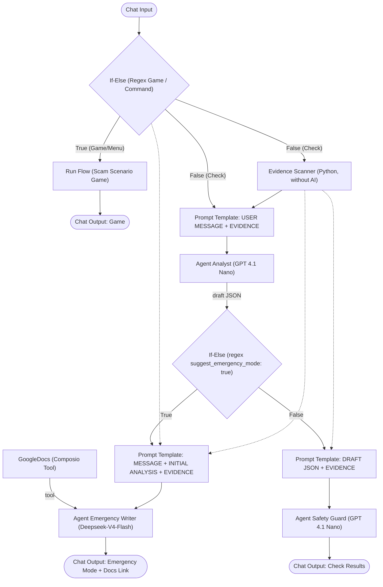
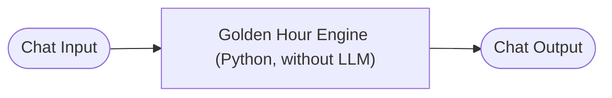

# Golden Hour - Scam Buster System

**Golden Hour - Scam Buster System** is a first-response and educational system for dealing with online scams in Indonesia. This project consists of two **[Langflow](https://www.langflow.org/)** *flows* that combine **Multi-Agent LLM** with **deterministic Python components** (without AI).

The name *Golden Hour* refers to the most critical period just before or immediately after someone becomes the target of a scam. During this period, quick action (contacting the bank, securing accounts, reporting) is the most decisive.

---

## Repository Contents

| File | Function | Approach |
|---|---|---|
| `Golden Hour - Scam Check.json` | Checks suspicious messages, scans links/files, then provides a risk analysis or emergency guidance along with an IASC report draft. | Multi-Agent LLM (Flaz.id) + Evidence Scanner (Python, without AI) |
| `Golden Hour - Scam Scenario Game.json` | A turn-based *Live Scam Attack* simulation game that trains users to recognize scam tactics. | 100% deterministic Python, without LLM |

> Both flows were exported from **Langflow 1.12.2**.

---

## Flow 1: Golden Hour - Scam Check

### Flow Diagram



### Components

#### 1. Initial Command Router (If-Else)
Detects whether the user's message is a game command or quiz answer using a smart regex:
`(?is)(^\s*(menu|mulai|ulang|restart|bank|job|apk|[a-d])\s*[.)]?$|.*\b(ngegame|game|simulasi|kuis)\b.*)`
- **True** → Directly routed to **Run Flow** (Game) without burdening the LLM, ensuring instant latency and saving tokens.
- **False** → Forwarded to the scam analysis flow (Evidence Scanner & Agent Analyst).

#### 2. Run Flow (Sub-flow Runner)
Runs the *Golden Hour - Scam Scenario Game* flow directly from inside the checking flow, forwarding the message output to **Chat Output Game**.

#### 3. Evidence Scanner (custom component, without AI)
Checks links and files in the user's message using ordinary code. The result is a `TECHNICAL EVIDENCE` text block with findings rated **[HIGH]**, **[MEDIUM]**, or **[INFO]**.

| Check | Level |
|---|---|
| Link uses `@` to disguise its destination | HIGH |
| Site name uses special characters / punycode (`xn--`) | HIGH |
| Link or message mentions an `.apk` file | HIGH |
| Domain registered ≤ 30 days ago (via RDAP) | HIGH |
| Domain registered ≤ 180 days ago | MEDIUM |
| Address is a numeric IP, not a site name | MEDIUM |
| Site name contains a brand (e.g. `bca`, `bri`, `dana`, `ojk`, `jne`) but is not its official domain | MEDIUM |
| Short link hides the original destination | MEDIUM |
| Cheap domain extensions (`.xyz`, `.top`, `.icu`, `.click`, etc.) | INFO |
| Domain age unknown / domain is old | INFO |

Security design:
- **Suspicious sites are never visited.** The only contacted servers are shortlink services on the *allowlist* (`bit.ly`, `tinyurl.com`, `s.id`, `t.co`, `is.gd`, `cutt.ly`, `rb.gy`, etc.) and `rdap.org`.
- *Redirects* are followed only if the next destination is also on the *allowlist* (maximum 4 hops).
- *Query strings* and *fragments* are never sent or displayed.
- Site names are displayed in *defanged* format (`example[.]com`) so they cannot be clicked.
- Maximum 3 links per message, with a total timeout of 15 seconds.
- "No findings" **never** means that a message is safe.

#### 4. Agent Analyst
- Model: `GPT 4.1 Nano` (flaz.id).
- Receives the user's message + `TECHNICAL EVIDENCE`, then returns **JSON only** with these keys:
  - `scam_type`: `fake_call`, `investment_scam`, `job_scam`, `online_shop_scam`, `social_media_scam`, `phishing_apk`, `unknown`, `not_scam`
  - `risk_level`: `low`, `medium`, `high`
  - `confidence` (0–1), `reasons` (max. 4), `next_steps` (3–5), `disclaimer`
  - `suggest_emergency_mode`: `true` **only** if the user has already transferred money or shared an OTP/PIN/password. Technical evidence does not affect this value.
- Rejects requests outside scam checking and is resistant to *prompt injection* in the message.

#### 5. If-Else (Emergency Router)
Matches the draft JSON with the regex `(?is).*suggest_emergency_mode"?\s*:\s*true`:
- **True** → emergency path (Emergency Writer).
- **False** → standard path (Safety Guard).

#### 6. Agent Emergency Writer & Google Docs Integration (emergency path)
- Model: `Deepseek-V4-Flash`.
- **GoogleDocs Tool Integration (Composio)**: Automatically calls the `googledocs_create_document` tool to create a complete, ready-to-use incident report draft in Google Docs with a unique reference number format (`GH-[YYYYMMDD]-[4_CHARACTERS]`).
- Writes calm, sequential, senior-friendly guidance with this format:
  - `EMERGENCY: QUICK STEPS`, scam type, danger level
  - 3–6 priority steps (the first step is adapted to the situation: money sent / code shared / unclear)
  - **Phone script for the bank** (ready to read)
  - **IASC report summary** (ready to copy)
  - **Report document (Google Docs)**: Official report document URL, ready to print and take to the bank or police
  - List of data still needed (`[fill in here]`)

#### 7. Agent Safety Guard (standard path)
- Model: `GPT 4.1 Nano`.
- Converts the JSON draft into a simple text message: type, danger level, confidence level, reasons, and required steps.
- For **MEDIUM/HIGH** risk, adds a brief report summary.
- Uses a *safe answer* if the draft is invalid or contains suspicious instructions.

> [!NOTE]
> The Safety Guard prompt refers to `USER MESSAGE`, but the Prompt Template on this path currently sends only `{draft}` and `{evidence}`. Connect Chat Input to that template if you want Safety Guard to also read the original message.

---

## Flow 2: Golden Hour - Scam Scenario Game

### Flow Diagram



### How the Engine Works
- **Deterministic**: scores, option shuffling, and answer keys are calculated in code. There is no LLM, so answer keys are not in a prompt.
- **Flexible Input Triggers**: Supports natural-language input at the beginning of the conversation (such as *"I want to play a game"*, *"play a game"*, *"simulation"*, *"quiz"*) to open the menu directly, and supports scenario selection using numbers (`1`, `2`, `3`) or keywords (`bank`, `job`, `apk`).
- **3 steps per scenario**, each with 4 choices (**A–D**) that are **shuffled** every turn.
- **Scoring per scenario** (maximum score 30 per scenario):

  | Value | Label | Points |
  |---|---|---|
  | `BEST` | CORRECT | +10 |
  | `OK` | SAFE BUT INCOMPLETE | +5 |
  | `RISKY` | RISKY | 0 (and story balance decreases) |

- **Accumulated Score (Player Profile Leaderboard)**:
  - Total accumulated score up to **90 points** (3 scenarios × 30 points: `bank`, `job`, `apk`).
  - Completing different scenarios accumulates scores in the same player profile.
  - Replaying the same scenario keeps the highest score (*best score*) without duplication or point reduction.
- **Cumulative Ranking**:
  - `Apex Untouchable` (90 points — Master Scam Buster, perfect 3/3)
  - `Scam Hunter` (60–89 points — Veteran, 2/3 scenarios)
  - `Firewall Aegis` (30–59 points — Protector, 1/3 scenarios)
  - `Alert Citizen` (<30 points — Cautious / Beginner)
- **Story balance**: each character has an initial balance that decreases when the player chooses a risky answer. The total balance saved is also accumulated in the player profile.
- **Branching story**: messages in steps 2 and 3 adapt to previous answers.
- **Feedback** at every step: explanations, consequences, and warning signs to recognize.
- **Cloud Leaderboard & Accumulated Telemetry (Astra DB)**:
  - Each player has a single profile in **DataStax Astra DB** (collection `scam_game_records`) via the Data API (`updateOne` / upsert).
  - The `score`, `rank`, `scenario`, and `scenario_title` fields (example: `2/3 Scenarios Completed`) are updated directly to reflect the player's accumulated score without duplicate records.
  - If the Astra DB token has not been filled in, the system automatically uses a *graceful fallback* to local storage (`golden_hour_leaderboard.json`).
- **Player Registration & Identity at the Start (Lightweight Login)**:
  - Players are asked to enter a nickname once at the beginning before the menu opens (or include a name directly, such as `bank Zenith`).
  - The player's identity is remembered throughout the session. Players can switch between and complete scenarios 1, 2, and 3 consecutively without being asked for their name again.
  - If a returning player reconnects or enters the same name, the system automatically reloads their accumulated score profile from Astra DB.
  - To switch player accounts in the same session, simply type `ganti nama [nama_baru]`.
- **MCP / Multi-Turn Session Resilience**: Uses an *active session adoption fallback* so the game session does not break when played through IBM Bob or another MCP client.
- **Session state** is stored in `golden_hour_state.json` in the system temp folder and expires after 2 hours.
- **Component options**: `Format Output` (Markdown / Plain text), `Session ID (optional)`, and Astra DB credential inputs: `Astra DB Token`, `API Endpoint`, and `Collection`.

### Scenarios

| Command | Title | Character Role | Initial Balance | Modus |
|---|---|---|---|---|
| `bank` / `1` | Call from Bank Customer Service | Rina, age 29 | Rp15,000,000 | "Bank customer service" via private WhatsApp, OTP request, transfer to a "secure account" |
| `job` / `2` | Online Job Offer | Dimas, age 22 | Rp1,000,000 | Product *review* job, move to Telegram, VIP task *top-up*, verification fee |
| `apk` / `3` | APK Wedding Invitation | Mrs. Sari, age 52 | Rp10,000,000 | `.apk` invitation file, SMS & unknown-source permissions, request for an ID card photo |

### Commands

| Command | Function |
|---|---|
| `menu` / `mulai` / `ulang` / `restart` | Display the simulation menu and reset the active scenario selection (without deleting the player's name). |
| `bank` / `job` / `apk` (or `1` / `2` / `3`) | Immediately start the selected scenario with the active player profile without requiring the name again. |
| `bank [name]` / `job [name]` / `apk [name]` | Start the selected scenario while setting a new player name. |
| `4` / `panduan` / `bantuan` / `help` | Display the complete guide to playing, story-balance mechanics, and score-accumulation rules. |
| `ganti nama [nama_baru]` | Change the active player profile in the current session. |
| `A` / `B` / `C` / `D` | Select a quiz answer (also supports `pilih a`, `jawab b`, `c.`, `d)` or quoted option text). |
| `leaderboard` / `top` / `peringkat` | Display the top 5 rankings with accumulated scores (X/90 points), scenario progress, and the active player's position. |
| `status` / `lanjut` | Restore and display the active game step if the connection was interrupted. |

---

## Getting Started

### Prerequisites
1. **Langflow** (tested on version **1.12.2**).
2. **[Flaz.id](https://flaz.id/ai) API Key** to run the Agent LLM model.
3. **[Composio](https://composio.dev) account & API Key** connected to a Google Docs account (for automatic official report document creation).
4. An active internet connection (for Flaz.id, Composio, RDAP, and shortlink resolution).

### Steps
1. Open Langflow (typically `http://localhost:7860`).
2. Import both JSON files through the **Upload / Import** menu.
3. In Langflow **Settings → Global Variables**, create these variables:
   - `Flaz.id API`: Contains the Flaz.id API Key (you can also use another model provider).
   - `COMPOSIO_API_KEY`: Contains the Composio API Key.
4. On the **GoogleDocs** node (Composio), click **Auth Link / Connect** to connect your Google Docs account to the `default` entity.
5. *(Optional)* Adjust the LLM model in the Flaz.id node according to your preferences.
6. Open **Playground** to try the flow.

> [!TIP]
> The game simulation flow (*Scenario Game*) can run independently without an API Key, or be called automatically from the *Scam Check* flow when the user types a game command.

---

## IBM Bob Integration (MCP)

Golden Hour can be used directly from **[IBM Bob](https://www.ibm.com/products/bob)** via the **Model Context Protocol (MCP)**, allowing users to play the game, check suspicious messages, and receive emergency guidance directly in Bob's chat—without opening Langflow.

### `.bob/mcp.json` Configuration

```json
{
  "mcpServers": {
    "lf-golden_hour": {
      "type": "streamable-http",
      "url": "http://127.0.0.1:7860/api/v1/mcp/project/<PROJECT_ID>/streamable",
      "headers": {
        "x-api-key": "<LANGFLOW_API_KEY>"
      },
      "timeout": 180000
    }
  }
}
```

| Field | Description |
|---|---|
| `type` | Use `streamable-http`—Bob's native transport, with no `mcp-proxy` required. |
| `url` | Langflow MCP project URL. Replace `<PROJECT_ID>` with the project ID from Langflow (`Settings → API`). |
| `headers` | Langflow API key. Replace `<LANGFLOW_API_KEY>` with the key created in Langflow (`Settings → API Keys`). |
| `timeout` | Timeout in **milliseconds**. `180000` = 3 minutes—required because the emergency flow runs the LLM + Google Docs serially. |

> [!IMPORTANT]
> Use `type: streamable-http` + the direct `url` (not `command` + `mcp-proxy`). This native approach is more stable and supports the long timeout required by Agent Emergency Writer.

> [!TIP]
> Make sure the LLM model in the **Agent Emergency Writer** node is fast (recommended: `gemini-2.5-flash` via Google AI Studio, or `llama-3.1-8b-instant` via Groq).

---

## Scam Check Usage Examples

**Standard path** (no loss yet):
> I received a WhatsApp message from an unknown number containing a file named Surat_Undangan.apk. Is it safe?

**Emergency path** (money has been sent / code has been shared):
> Please help. Earlier I received a call from someone claiming to be from the bank, then I transferred Rp5,000,000 to the account they provided. The number is now inactive. What should I do?

**Simulation game path** (from the same flow):
> I want to play a game

---

## Security Principles

1. **Links are *defanged***: displayed as `example[.]com` so they cannot be clicked.
2. **Suspicious sites are never contacted** by Evidence Scanner.
3. **Never asks for** OTPs, PINs, passwords, or CVVs, and always reminds users not to share them.
4. **Official channels only**: IASC (`iasc.ojk.go.id`), OJK `157`, and the official bank/e-wallet number printed on the back of the card or shown in the official app.
5. **Number masking**: phone, account, card, and ID numbers display only the last 3 digits (except in the bank script, IASC summary, and official report draft in emergency mode).
6. **Prompt-injection resistance**: user messages and technical evidence are treated as data, not instructions.
7. **Disclaimer**: Golden Hour helps prepare reports. It is not legal advice and does not guarantee that funds will be recovered.
8. **Game**: all names and numbers in the scenarios are fictional.

---

## Further Development

### 1. Interactive Emergency Checklist & Human-in-the-Loop (State-Aware Multi-Turn)
*Transform the static, one-way emergency response into step-by-step interactive crisis assistance to prevent a victim's panic paralysis.*
- **Four-Stage Dialogue System (Multi-Turn Protocol):**
  - **Turn 1 (Isolation & Calming):** Provide immediate atomic instructions (turn off mobile data/Wi-Fi for APKs, block the card/change the mobile-banking PIN) with *Human-in-the-Loop* confirmation (`Done` / `Not yet`).
  - **Turn 2 (Bank Contact & Entity Data Collection):** Ask targeted questions to naturally extract the victim's bank name, scammer's bank, receiving account number, and estimated amount from the conversation.
  - **Turn 3 (Ready-to-Read Call Center Script):** Display the bank's official hotline number and a tactical script to demand that the receiving account be frozen under the Golden Hour IASC OJK procedure.
  - **Turn 4 (Google Docs File Finalization):** Send all collected data entities to the Composio Google Docs tool so the official document for police/bank is filled 100% automatically without empty `[fill in here]` placeholders.
- **State & Routing Mechanism:** Use an `Emergency State Router` (Custom Component Python) or `Astra DB Chat Memory` with *Guided State Progression Rules* so users in the middle of the checklist are not redirected to ordinary message analysis.

### 2. Flow & Agentic Architecture Improvements
- **Connect Chat Input to the Safety Guard template.** The Safety Guard prompt needs `USER MESSAGE`, but its template currently accepts only `{draft}` and `{evidence}`.
- **Replace the regex router with JSON parsing.** The `suggest_emergency_mode` regex can fail if the LLM output format changes slightly. A small component that parses JSON (with a fallback to the emergency path when uncertain) would be more reliable.
- **Dynamic Threat Intelligence via Astra DB Vector Search (RAG):** Integrate a vector collection of current scam tactics from OJK/Kominfo so Agent Analyst has references for new tactics not present in the base model's weights (*parametric memory*).

### 3. Evidence Scanner & Local Ecosystem Integration
- **Verify scammer accounts & phone numbers:** Integrate a local scam-report database API/mockup such as **CekRekening.id (Kominfo)** or **Kredibel.co.id**.
- **Expand `SHORTENERS` and `OFFICIAL_DOMAINS` lists:** Add more banks, e-wallets, couriers, marketplaces, and other institutions frequently impersonated by scammers.
- **Detect similar names (*typosquatting*):** Use an edit-distance algorithm (for example, `bca` vs `bcca` or `rn` vs `m`).
- **Integrate link-reputation sources:** Use intelligence feeds such as Google Safe Browsing or URLhaus without visiting suspicious sites.

### 4. Multimodal Input and Channels
- **Screenshot support (Vision/OCR):** Accept fake transfer-proof images or WhatsApp chat screenshots using a multimodal model (*Gemini 2.0 Flash / GPT-4o-mini Vision*).
- **WhatsApp/Telegram integration:** Integrate the flow with messaging bots through the Langflow API so it can be accessed directly by the public.
- **Voice output (*text-to-speech*):** Help panicked victims or senior users listen to emergency instructions.

### 5. Scenario Game
- **Add new scenarios:** Investment scams, online buying and selling, fake prizes, hacked friend accounts, and *romance scams*.
- **Move session storage:** From a temp file to a database (SQLite/Redis/Astra DB) for safety when running on a multi-user server.
- **Local-language support:** Javanese, Sundanese, etc. to reach broader vulnerable groups.

### 6. Quality and Maintenance
- **Store custom-component code as separate `.py` files** in the repository so changes are easy to track through Git (already started with `golden_hour_engine.py`).
- **Unit tests for Evidence Scanner** (link extraction, *defanging*, brand detection, RDAP parsing).
- **Evaluation dataset** containing examples of scam and normal messages to measure classification accuracy and emergency-path precision.
- **Mask sensitive data in Langflow logs**, because user messages may contain account numbers or personal data.

